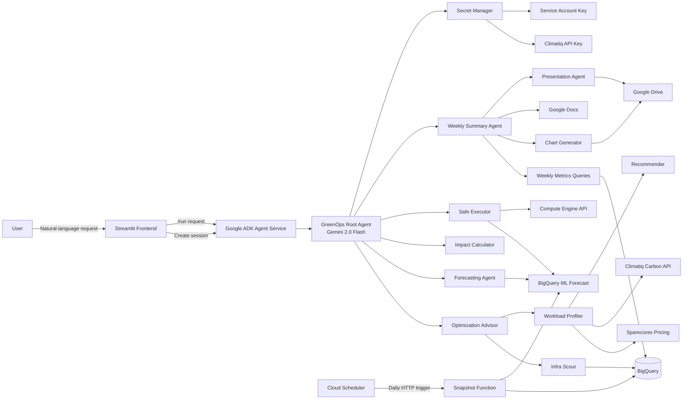
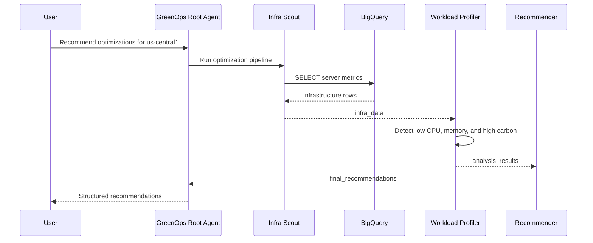
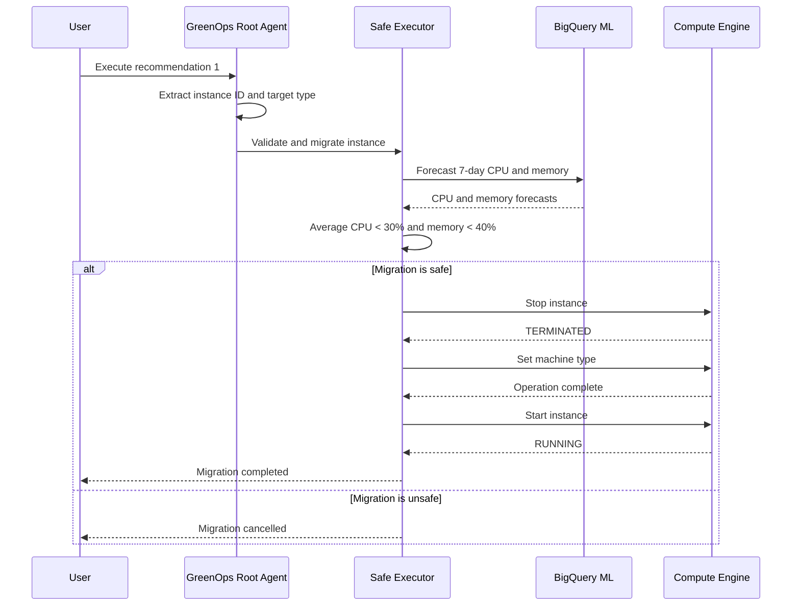
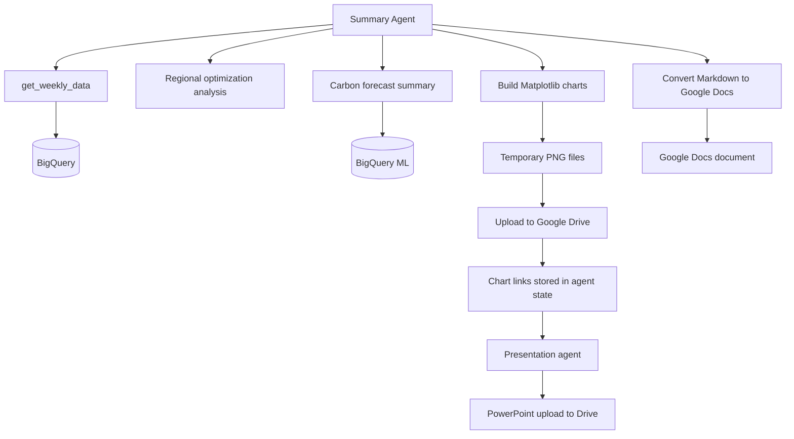
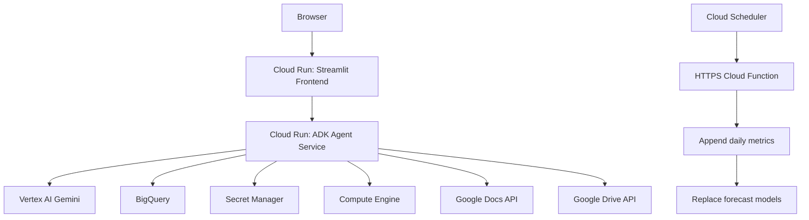

# GreenOps System Design

## 1. Overview

GreenOps is a multi-agent cloud sustainability platform built for Google Cloud. It helps users:

- Discover underutilized and high-carbon GCP infrastructure
- Forecast CPU, memory, and carbon usage
- Compare cost and carbon impact across instance types
- Execute approved VM right-sizing operations
- Generate weekly Google Docs reports and PowerPoint presentations

The system has four main planes:

1. **Presentation plane**: Streamlit chat UI
2. **Agent orchestration plane**: Google ADK agents using Gemini
3. **Data and ML plane**: BigQuery, time-series metrics, and ARIMA_PLUS models
4. **GCP action plane**: Compute Engine operations, Secret Manager, Docs, and Drive

## 2. High-Level Architecture



## 3. Runtime Components

| Component | Responsibility | Technology |
|---|---|---|
| Streamlit frontend | Session management and chat UI | Streamlit, HTTP requests |
| Root agent | Routes requests to specialist agents | Google ADK, Gemini 2.0 Flash |
| Infra scout | Queries current GCP infrastructure metrics | Google ADK, BigQuery |
| Workload profiler | Finds low-utilization resources and estimates savings | ADK agent, Climatiq, Sparecores |
| Recommender | Formats optimization findings into recommendations | Google ADK |
| Forecasting agent | Forecasts CPU, memory, or carbon | BigQuery ML ARIMA_PLUS |
| Impact calculator | Compares cost and carbon for instance changes | Climatiq, Sparecores, web search fallback |
| Safe executor | Forecasts resource headroom and performs a migration | BigQuery ML, Compute Engine API |
| Summary agent | Builds weekly report content and charts | BigQuery, Matplotlib, Google Docs |
| Presentation agent | Creates a weekly PPTX presentation | python-pptx, Google Drive |
| Snapshot function | Appends daily metrics and rebuilds forecast models | Cloud Functions, BigQuery |
| Scheduler | Triggers snapshot and retraining daily | Cloud Scheduler |

## 4. Agent Orchestration

### 4.1 Root Routing

The root agent receives a natural-language request and delegates based on intent:

- Recommendation request → optimization advisor
- Forecast or prediction request → forecasting agent
- Instance comparison request → impact calculator
- Explicit migration request → safe executor
- Weekly report request → summary agent

Session state is created by the frontend and sent with every `/run` call.

### 4.2 Optimization Pipeline



The optimization pipeline is a sequential Google ADK pipeline:

1. `infra_scout_agent`
2. `workload_profiler_agent`
3. `infra_recommender_agent`

The workload profiler uses configured thresholds:

- CPU utilization below 30%
- Memory utilization below 40%
- Total carbon above 1 kg/day

It queries external cost and carbon data before generating the final recommendation.

### 4.3 Safe Execution Pipeline



## 5. Data Architecture

### 5.1 Operational Metric Tables

The system uses BigQuery datasets under `greenops-460813.gcp_server_details`.

**server_metrics**

Stores the current server metric snapshot.

Key fields:

- `Instance_ID`
- `Instance_Type`
- `Region`
- `Average_CPU_Utilization`
- `Memory_Utilization`
- `Disk_IOPS`
- `Network_IOPS`
- `Total_Carbon_Emission_in_kg`

**server_metrics_timeseries**

Stores daily snapshot records for forecasting and reports.

Key fields:

- `date`
- `instance_id`
- `instance_type`
- `region`
- `cpu_util`
- `memory_util`
- `disk_iops`
- `network_iops`
- `total_carbon`

### 5.2 Forecast Models

Daily snapshot execution creates or replaces three ARIMA_PLUS models:

| Model | Target |
|---|---|
| `server_cpu_forecast_model` | CPU utilization |
| `server_mem_forecast_model` | Memory utilization |
| `server_carbon_forecast_model` | Carbon emissions |

All models use `date` as the timestamp column and `Instance_ID` as the time-series identifier.

### 5.3 External Data Sources

- **Climatiq**: GCP instance carbon estimates
- **Sparecores**: GCP instance pricing data
- **Google Search**: Fallback for unavailable pricing data

## 6. Document and Presentation Flow



The four report charts are:

- Carbon time series
- Regional CPU and memory utilization
- CPU versus carbon by instance
- Under-utilization rate over time

## 7. Deployment Architecture



### Deployment recommendations

- Deploy the frontend as a containerized Cloud Run service.
- Deploy the ADK agent service as a separate Cloud Run service.
- Deploy the snapshot and model retraining function independently.
- Run the scheduler in the UTC or project-defined timezone.
- Keep agent and frontend services behind least-privilege service accounts.

## 8. Security and Governance

### Current controls

- Secrets are retrieved from Google Secret Manager.
- The service account key is used to call Google Docs and Drive APIs.
- VM changes stop, resize, and restart only the selected instance.
- A migration is skipped if forecasted average CPU or memory exceeds its threshold.

### Required controls for production

1. Replace hard-coded project IDs with environment configuration.
2. Remove broad public Drive and document permissions and use an allowlist or organization domain.
3. Require explicit user approval for every VM mutation.
4. Add a per-session and per-user authorization check.
5. Separate read-only and mutation service accounts.
6. Validate that the requested instance and target machine type exist in the selected zone.
7. Add rollback and post-migration health checks.
8. Add audit logs for recommendation, approval, execution, and rollback events.
9. Store API keys only in Secret Manager and never in source or environment logs.

## 9. Reliability and Failure Handling

| Failure | Current behavior | Recommended behavior |
|---|---|---|
| BigQuery unavailable | Agent returns an error result | Retry with exponential backoff; surface dependency status |
| Forecast model missing | Forecast query fails | Run snapshot retraining or block migration |
| Climatiq unavailable | Carbon estimate fails | Mark estimate unavailable; do not present as zero |
| Sparecores unavailable | Price lookup fails | Use configured pricing fallback or official pricing link |
| Compute stop/start timeout | Migration raises timeout or operation error | Add status reconciliation and rollback |
| Docs/Drive upload fails | Report or presentation generation fails | Retry uploads and retain a document job state |
| Partial chart generation | Placeholder may remain | Build charts transactionally or add dead-letter handling |

## 10. Scalability and Operations

- Keep the Streamlit frontend stateless aside from browser session state.
- Store server and agent sessions in an externally managed session store as usage grows.
- Use BigQuery partitioning and clustering for large time-series tables.
- Cache instance prices and carbon estimates when the underlying data changes slowly.
- Add idempotency keys to VM mutation operations.
- Use structured logs and trace IDs across frontend, root agent, tools, and GCP operations.
- Monitor:
  - Agent latency
  - Tool success and failure rates
  - Forecast freshness
  - BigQuery cost
  - VM mutation success rate
  - Report and presentation generation duration

## 11. Key API and Interface Contracts

### Frontend to ADK

Create session:

```text
POST /apps/{app_name}/users/{user_id}/sessions/{session_id}
```

Run agent:

```json
{
  "app_name": "greenops_agent",
  "user_id": "user-id",
  "session_id": "session-id",
  "new_message": {
    "role": "user",
    "parts": [
      {
        "text": "Natural-language request"
      }
    ]
  }
}
```

### VM Migration

The executor requires:

- Instance ID
- Target machine type

It returns a success, cancellation, or error result after validating forecasts and performing the Compute Engine lifecycle operations.

## 12. Evolution Roadmap

### Near term

- Move configuration into environment variables
- Add IAM-based authorization and mutation confirmation
- Add typed tool contracts and structured agent outputs
- Add retries, idempotency, and rollback

### Medium term

- Add persistent job and recommendation state
- Add scheduled policy evaluation
- Add cost anomaly detection
- Add audit dashboard and notification integrations

### Long term

- Support multiple GCP projects and organizations
- Support policy-as-code for allowed machine families and regions
- Train optimization models from approved or rejected recommendations
- Extend to additional cloud providers
